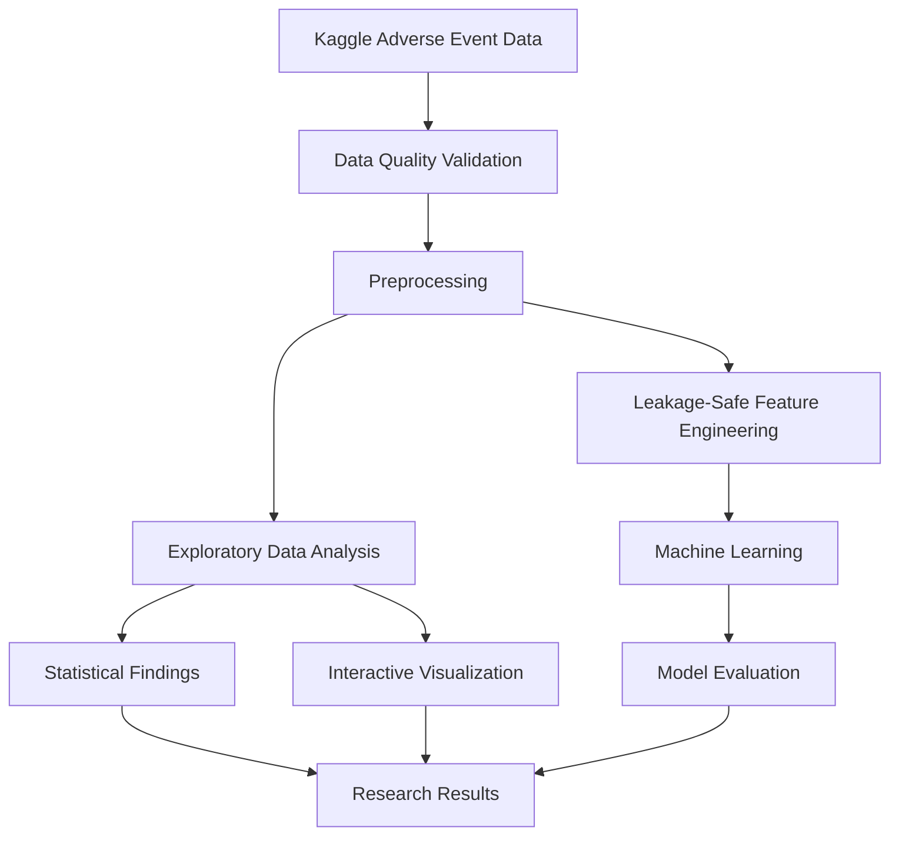

<div align="center">

# GLP-1 Safety Analytics

### Adverse Event Reporting Patterns & Seriousness Prediction

**Exploring Drug Safety Reports Through Statistics, Visualization and Machine Learning**

<br>

`PHARMACOVIGILANCE` · `STATISTICAL ANALYSIS` · `INTERACTIVE VISUALIZATION` · `MACHINE LEARNING`

<br>

**2026 RESEARCH PROJECT | TEAM 06**

---

[Overview](#overview) ·
[Research](#research-objectives) ·
[Dataset](#dataset) ·
[Pipeline](#analysis-pipeline) ·
[Visualization](#visual-analytics) ·
[Prediction](#machine-learning) ·
[Conference](#research--publication)

</div>

<br>

## Overview

### Understanding GLP-1 Adverse Event Reporting Patterns

**GLP-1 Safety Analytics**는 GLP-1 계열 의약품의 이상사례 보고 데이터를 분석하여 의약품별·시계열별 신고 패턴을 탐색하고, 중대 신고 여부를 예측하는 데이터사이언스 연구 프로젝트입니다.

통계 분석과 탐색적 데이터 분석(EDA)을 핵심 연구 방법으로 활용하며, 인터랙티브 데이터 시각화 및 머신러닝 기반 이진 분류 모델을 결합합니다.

### Research Focus

<table>
<tr>
<td width="33%" align="center">
<h3>01 / EXPLORE</h3>
<b>Statistical Analysis</b>
<p>의약품별 이상사례 보고 분포와 시간적 변화 탐색</p>
</td>
<td width="33%" align="center">
<h3>02 / VISUALIZE</h3>
<b>Interactive Analytics</b>
<p>분석 결과를 탐색할 수 있는 시각화 및 대시보드</p>
</td>
<td width="33%" align="center">
<h3>03 / PREDICT</h3>
<b>Machine Learning</b>
<p>보고 특성을 활용한 중대 신고 여부 예측</p>
</td>
</tr>
</table>

> **Research Scope**
>
> 본 프로젝트는 자발적 이상사례 보고 데이터의 특성과 신고 패턴을 분석합니다. 보고 건수나 예측 결과를 의약품의 실제 부작용 발생률 또는 인과관계로 해석하지 않습니다.

---

## Research Objectives

### Core Research Questions

| ID | Research Question |
|:---:|---|
| RQ1 | GLP-1 계열 의약품별 이상사례 신고 분포에는 어떤 차이가 나타나는가? |
| RQ2 | 시간에 따라 이상사례 보고량과 중대 신고 비율은 어떻게 변화하는가? |
| RQ3 | 주요 보고 특성에 따라 중대 신고 비율에 어떤 차이가 나타나는가? |
| RQ4 | 데이터 누수를 통제한 머신러닝 모델로 중대 신고 여부를 어느 정도 예측할 수 있는가? |

### Analytical Approach

| Research Component | Method |
|---|---|
| Descriptive Statistics | 빈도, 비율, 분포 분석 |
| Comparative Analysis | 의약품 및 보고 특성별 비교 |
| Temporal Analysis | 연도별·월별 신고 추세 |
| Visual Analytics | 인터랙티브 차트 및 대시보드 |
| Predictive Modeling | 중대 신고 여부 이진 분류 |
| Model Evaluation | ROC-AUC, PR-AUC, F1, Recall 등 |

---

## Dataset

### Data Source

**Kaggle — GLP-1 Adverse Event Reports**

| Attribute | Description |
|---|---|
| Dataset | GLP-1 계열 의약품 이상사례 데이터 |
| Source | Kaggle |
| Original File | `adverse_events.csv` |
| Domain | Pharmacovigilance |
| Analysis Unit | 이상사례 신고 기록 |
| Target | 중대 신고 여부 (Binary Classification) |

### Data Quality & Preprocessing

분석 전 데이터 품질을 검토하고, 일관된 신고 단위와 분석 기준을 확보합니다.

- 중복 신고 ID 및 동일 신고의 반복 기록 검토
- 주요 변수의 결측치 및 비정상 값 확인
- 신고 날짜의 유효성 및 분석 기간 검증
- 중대 신고 여부 라벨의 정의 및 충돌 검토
- 예측 모델에 사용되는 변수의 데이터 누수 검토

> 중대 신고 여부는 데이터에서 정의한 기준에 따라 생성하며, 결과를 직접 결정하는 변수는 예측 입력에서 제외합니다.

---

## Analysis Pipeline



### Workflow

| Stage | Description | Deliverable |
|:---:|---|---|
| 01 | Data Validation | Quality Diagnostics |
| 02 | Data Preprocessing | Analysis-Ready Dataset |
| 03 | Statistical EDA | Descriptive Statistics |
| 04 | Temporal & Drug Analysis | Comparative Figures |
| 05 | Interactive Visualization | Visual Dashboard |
| 06 | Predictive Modeling | Classification Models |
| 07 | Research Interpretation | Paper & Findings |

---

## Exploratory Data Analysis

### A. Drug-Specific & Temporal Analysis

의약품별 이상사례 신고 특성과 시간에 따른 보고 패턴을 분석합니다.

**Analysis Topics**

- GLP-1 의약품별 신고 건수 및 구성비
- 의약품별 중대 신고 비율 비교
- 연도별·월별 이상사례 신고 추세
- 시간에 따른 의약품별 신고 패턴 변화

### B. Report Characteristics & Seriousness Analysis

신고 특성에 따른 분포와 중대 신고 여부의 관계를 탐색합니다.

**Analysis Topics**

- 신고 특성별 분포 비교
- 중대 신고와 비중대 신고의 특성 비교
- 주요 변수와 중대 신고 여부 간 관계 탐색
- 데이터 불균형 및 분석상 한계 검토

---

## Visual Analytics

### Interactive Data Exploration

정적 통계 그래프를 넘어 사용자가 조건을 선택하여 신고 패턴을 탐색할 수 있는 시각화 환경을 목표로 합니다.

| Component | Function |
|---|---|
| Drug Filter | 의약품별 데이터 탐색 |
| Time Filter | 분석 기간 선택 |
| Seriousness Filter | 중대·비중대 신고 비교 |
| Trend Analysis | 시계열 신고 패턴 |
| Comparative View | 의약품별 특성 비교 |

### Visualization Gallery

| FIGURE 01 | FIGURE 02 |
|:---:|:---:|
| **Drug-Specific Reporting Patterns** | **Temporal Reporting Trends** |
| 의약품별 신고 분포 | 연도별·월별 신고 변화 |
| Figure to be added | Figure to be added |

| FIGURE 03 | FIGURE 04 |
|:---:|:---:|
| **Serious Reporting Ratio** | **Predictive Model Evaluation** |
| 의약품별 중대 신고 비율 | 모델 성능 비교 |
| Figure to be added | Figure to be added |

*실제 시각화 결과가 준비되면 그래프 이미지 및 대시보드 링크로 교체합니다.*

---

## Machine Learning

### Seriousness Classification

이상사례 신고 기록의 특성을 기반으로 중대 신고 여부를 예측하는 이진 분류 문제를 다룹니다.

**Prediction Target**

```text
0 = Non-serious Report
1 = Serious Report
```

### Modeling Strategy

| Component | Description |
|---|---|
| Task | Binary Classification |
| Baseline | Logistic Regression |
| Candidate Model | Random Forest |
| Validation | 데이터 누수와 중복 신고를 고려한 분할 |
| Evaluation | ROC-AUC, Average Precision, F1, Recall |
| Interpretation | 주요 예측 변수 및 모델 오류 분석 |

*모델 구성과 성능 수치는 실험 완료 후 확정합니다.*

### Important Considerations

- 중대 신고 여부를 직접 정의하는 변수의 입력 사용 금지
- 동일 신고의 학습·평가 데이터 간 중복 방지
- 클래스 불균형을 고려한 성능 평가
- 예측 결과와 의학적 인과관계의 구분

---

## Project Structure

아래는 프로젝트의 권장 저장소 구조입니다.

```text
GLP1-Safety-Analytics/
│
├── data/
│   ├── raw/
│   └── processed/
│
├── notebooks/
│   ├── preprocessing/
│   ├── eda/
│   │   ├── eda_a_drug_temporal.ipynb
│   │   └── eda_b_report_seriousness.ipynb
│   └── modeling/
│
├── src/
│   ├── preprocessing/
│   ├── visualization/
│   └── modeling/
│
├── dashboard/
│
├── outputs/
│   ├── figures/
│   └── tables/
│
├── paper/
│
├── requirements.txt
└── README.md
```

*표시된 폴더와 파일은 권장 구조이며 실제 저장소에 생성된 파일과 다를 수 있습니다.*

---

## Technology Stack

| Category | Technologies |
|---|---|
| Language | Python |
| Data Processing | Pandas, NumPy |
| Statistical Analysis | SciPy, Statsmodels |
| Visualization | Matplotlib, Seaborn, Plotly |
| Machine Learning | Scikit-learn |
| Environment | Google Colab, Jupyter Notebook |
| Collaboration | Git, GitHub |

*실제 사용한 라이브러리에 맞춰 업데이트합니다.*

---

## Research & Publication

### Target Conference

**(사)한국디지털산업학회 2026 추계학술대회**

| Item | Details |
|---|---|
| Conference Dates | December 11–12, 2026 |
| Presentation Date | December 12, 2026 |
| Venue | Sookmyung Women's University |
| Paper Length | 2 Pages |
| Submission Deadline | November 20, 2026 |
| Acceptance Notification | November 27, 2026 |
| Registration Deadline | December 4, 2026 |
| Research Fields | Big Data, Data Visualization, AX |

**Status: Preparing for Submission**

논문 채택 및 발표 여부는 학술대회 심사 결과에 따라 확정됩니다.

---

## Project Team

**Team 06 — Duksung Women's University**

Department of Data Science

본 프로젝트는 데이터 분석, 시각화 및 머신러닝 기반 예측 연구를 공동 수행합니다.

---

## Research Limitations

자발적 이상사례 보고 데이터에는 과소보고, 선택적 보고, 중복 신고 및 보고 시점의 차이 등이 존재할 수 있습니다.

따라서 본 프로젝트의 분석 결과는 신고 데이터 내부의 패턴을 설명하는 데 초점을 두며, 의약품 간 실제 안전성 우열이나 부작용 발생 위험을 직접 비교하는 근거로 사용하지 않습니다.

---

<div align="center">

### GLP-1 Safety Analytics

**Statistical Exploration · Interactive Visualization · Predictive Modeling**

Data-Driven Pharmacovigilance Research

<sub>Research Team 06 · 2026</sub>

</div>
