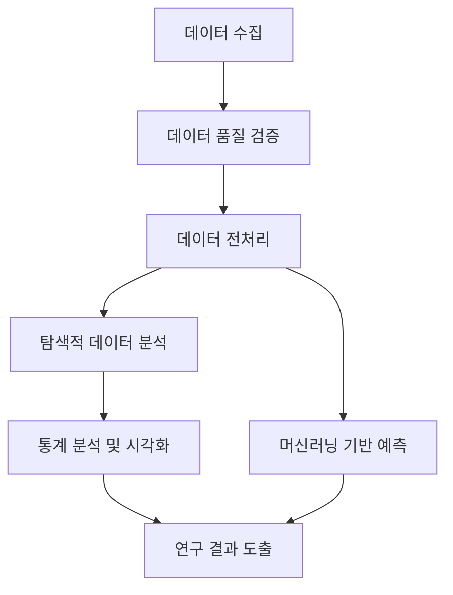

<div align="center">

# GLP-1 계열 의약품 이상사례 분석

### 신고 패턴 분석 및 머신러닝 기반 중대 신고 여부 예측

**GLP-1 Safety Analytics**

`통계 분석` · `탐색적 데이터 분석` · `인터랙티브 시각화` · `머신러닝`

---

</div>

## 프로젝트 개요

- **연구 주제:** GLP-1 계열 의약품의 이상사례 보고 패턴 분석 및 머신러닝 기반 중대 신고 여부 예측
- **연구 목적:** 의약품별 이상사례 신고 특성 파악 및 중대 신고 여부 예측
- **연구 방향:** 통계 분석 및 탐색적 데이터 분석(EDA) 중심
- **확장 요소:** 인터랙티브 데이터 시각화 및 머신러닝 기반 예측 모델
- **활용 데이터:** Kaggle GLP-1 계열 의약품 이상사례 데이터

### 핵심 연구 영역

| 영역 | 주요 내용 |
|---|---|
| 통계 분석 | 신고 건수, 구성비, 중대 신고 비율 분석 |
| 의약품별 분석 | 의약품별 신고 분포 및 특성 비교 |
| 시계열 분석 | 연도별·월별 신고 추세 분석 |
| 데이터 시각화 | 주요 분석 결과 시각화 및 대시보드 구성 |
| 머신러닝 | 중대 신고 여부 예측 및 모델 성능 평가 |

> **분석 범위**
> - 이상사례 신고 데이터의 통계적 패턴 분석
> - 실제 부작용 발생률 및 의약품 간 위험도 비교와 구분
> - 신고 데이터만으로 의약품과 이상사례의 인과관계 판단 불가

---

## 01. 데이터 및 전처리

### 데이터 정보

| 항목 | 내용 |
|---|---|
| 출처 | Kaggle |
| 데이터 | GLP-1 계열 의약품 이상사례 보고 데이터 |
| 원본 파일 | `adverse_events.csv` |
| 분석 대상 | GLP-1 계열 의약품 이상사례 신고 기록 |
| 예측 목표 | 중대 신고 여부 |

### 전처리 항목

- 중복 신고 ID 및 반복 기록 검토
- 결측치 및 비정상 값 확인
- 신고 날짜 유효성 검증
- 중대 신고 여부 라벨 생성 및 충돌 검토
- 데이터 누수 가능 변수 확인
- 전처리 진단 결과 별도 관리

---

## 02. 탐색적 데이터 분석

### A. 의약품별·시계열 분석

- 의약품별 이상사례 신고 건수 및 구성비
- 의약품별 중대 신고 비율
- 연도별·월별 신고 건수 변화
- 의약품별 시계열 신고 패턴 비교

### B. 신고 특성 및 중대 신고 분석

- 중대·비중대 신고 분포
- 주요 신고 특성별 분포 비교
- 신고 특성과 중대 신고 여부 간 관계
- 클래스 불균형 및 주요 통계적 특성

---

## 03. 데이터 시각화

### 시각화 구성

| 시각화 항목 | 주요 내용 |
|---|---|
| 의약품별 신고 분포 | 의약품별 신고 건수 비교 |
| 시계열 추세 | 연도별·월별 신고량 변화 |
| 중대 신고 비율 | 의약품별 중대 신고 비율 비교 |
| 인터랙티브 대시보드 | 의약품·기간·중대 여부별 필터링 |

### 주요 시각화 결과

**그림 1. 의약품별 이상사례 신고 분포**

- 의약품별 신고 건수 및 구성비 비교
- 시각화 이미지 추가 예정

**그림 2. 연도별·월별 신고 추세**

- 기간별 신고 건수 변화
- 시각화 이미지 추가 예정

**그림 3. 의약품별 중대 신고 비율**

- 의약품별 중대 신고 비율 비교
- 시각화 이미지 추가 예정

---

## 04. 머신러닝 기반 예측

### 예측 모델 구성

| 항목 | 내용 |
|---|---|
| 예측 목표 | 중대 신고 여부 |
| 문제 유형 | 이진 분류 |
| 비교 모델 | 로지스틱 회귀, 랜덤 포레스트 등 |
| 평가 지표 | ROC-AUC, AP, F1-score, Recall |
| 주요 검증 사항 | 데이터 누수, 중복 신고, 클래스 불균형 |

### 모델링 고려사항

- 중대 신고 라벨을 직접 결정하는 변수 제외
- 동일 신고의 학습·평가 데이터 간 중복 방지
- 클래스 불균형을 고려한 모델 성능 평가
- 예측 성능 및 주요 변수 중요도 분석
- 실제 부작용 위험도와 예측 결과의 구분

---

## 05. 분석 파이프라인



### 사용 기술

| 구분 | 기술 |
|---|---|
| 프로그래밍 | Python |
| 데이터 처리 | Pandas, NumPy |
| 통계 분석 | SciPy |
| 시각화 | Matplotlib, Seaborn, Plotly |
| 머신러닝 | Scikit-learn |
| 개발 환경 | Google Colab |
| 버전 관리 | GitHub |

---

## 06. 프로젝트 구조

```text
Data-Visualization-for-Big-Data-PBL-Team-06/
│
├── data/
│   ├── raw/                  # 원본 데이터
│   └── processed/            # 전처리 데이터
│
├── notebooks/
│   ├── preprocessing/        # 전처리 코드
│   ├── eda/                  # 탐색적 데이터 분석
│   └── modeling/             # 머신러닝 실험
│
├── visualization/            # 시각화 코드
│
├── dashboard/                # 인터랙티브 대시보드
│
├── results/
│   ├── figures/              # 분석 그래프
│   └── tables/               # 분석 결과표
│
├── paper/                    # 학술대회 논문
│
└── README.md
```

*권장 디렉터리 구조이며, 실제 저장소 구성에 따라 변경 가능*

---

## 07. 연구 진행 현황

| 단계 | 내용 | 상태 |
|---|---|---|
| 01 | 데이터 수집 | 완료 |
| 02 | 데이터 전처리 | 완료 |
| 03 | 탐색적 데이터 분석 A | 완료 |
| 04 | 탐색적 데이터 분석 B | 완료 |
| 05 | 데이터 시각화 | 진행 중 |
| 06 | 머신러닝 모델링 | 진행 예정 |
| 07 | 학술대회 논문 작성 | 진행 예정 |

---

## 08. 학술대회 및 연구 성과

### 한국디지털산업학회 2026 추계학술대회

| 항목 | 내용 |
|---|---|
| 논문 제출 마감 | 2026.11.20 |
| 발표 여부 통보 | 2026.11.27 |
| 사전등록 마감 | 2026.12.04 |
| 학술대회 일정 | 2026.12.11 ~ 12.12 |
| 발표 예정일 | 2026.12.12 |
| 장소 | 숙명여자대학교 |
| 논문 분량 | 2쪽 |
| 현재 상태 | 논문 제출 준비 중 |

### 연구 결과물

- 데이터 전처리 및 품질 검증 결과
- 의약품별·시계열 탐색적 데이터 분석 결과
- 주요 통계 그래프 및 인터랙티브 시각화
- 머신러닝 기반 중대 신고 예측 모델
- 학술대회 제출 논문

---

## 연구팀

- **소속:** 덕성여자대학교 데이터사이언스학과
- **팀명:** Team 06
- **연구 형태:** 2인 공동 연구
- **연구 분야:** 빅데이터 분석 · 데이터 시각화 · 머신러닝

---

<div align="center">

**GLP-1 Safety Analytics**

GLP-1 계열 의약품 이상사례 보고 패턴 분석 및 예측

<sub>2026 · Team 06</sub>

</div>
