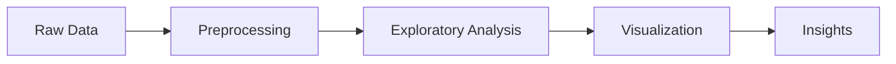

<div align="center">

# YOUR PROJECT NAME

### Data Analytics & Visualization Project

**Discover Patterns. Understand Data. Deliver Insights.**

<br>

`Python` · `Data Analytics` · `Visualization` · `Research`

<br>

[Overview](#overview) ·
[Features](#key-features) ·
[Pipeline](#analysis-pipeline) ·
[Results](#results--visualizations) ·
[Getting Started](#getting-started)

---

</div>

## Overview

### Turning complex data into actionable insights.

**YOUR PROJECT NAME**은 데이터 속의 주요 패턴과 관계를 분석하고, 시각화를 통해 의미 있는 인사이트를 도출하는 데이터 분석 프로젝트입니다.

본 프로젝트는 **[분석 주제 입력]**을 중심으로 실제 데이터를 수집·가공·분석하고, 분석 결과를 재현 가능한 코드와 시각적 결과물로 제공합니다.

### The Problem

> 이 프로젝트가 해결하려는 핵심 문제를 한두 문장으로 작성합니다.

기존 데이터에서 파악하기 어려웠던 패턴과 관계를 탐색하고, 데이터 기반으로 현상을 이해할 수 있는 분석 방법을 제시합니다.

### Our Approach

| DATA | ANALYSIS | VISUALIZATION |
|:---|:---|:---|
| 데이터 확보 및 품질 검증 | 통계 분석 및 패턴 탐색 | 분석 결과의 시각적 전달 |
| Raw → Processed | Exploration → Findings | Figures → Insights |

---

## Key Features

<table>
<tr>
<td width="50%" valign="top">
<h3>01. Data Processing</h3>
<p>원본 데이터를 분석 가능한 형태로 변환하고, 결측치·이상치 등 데이터 품질 문제를 처리합니다.</p>
</td>
<td width="50%" valign="top">
<h3>02. Exploratory Analysis</h3>
<p>데이터 분포와 주요 변수의 특성을 파악하고, 변수 간 관계와 패턴을 탐색합니다.</p>
</td>
</tr>
<tr>
<td valign="top">
<h3>03. Data Visualization</h3>
<p>다양한 시각화 기법을 활용하여 분석 결과를 이해하기 쉬운 형태로 표현합니다.</p>
</td>
<td valign="top">
<h3>04. Insight Generation</h3>
<p>분석 결과를 종합하여 핵심 인사이트를 도출하고 연구 결과를 문서화합니다.</p>
</td>
</tr>
</table>

---

## Analysis Pipeline

프로젝트의 데이터 처리 및 분석 흐름입니다.



### Pipeline Details

| Stage | Description | Output |
|---|---|---|
| Data Collection | 데이터 확보 및 출처 검토 | Raw Dataset |
| Preprocessing | 데이터 정제 및 변환 | Clean Dataset |
| EDA | 통계적 특성 및 관계 분석 | Analysis Results |
| Visualization | 데이터 시각화 | Figures |
| Interpretation | 분석 결과 해석 | Key Findings |

---

## Results & Visualizations

### Analysis Results

실제 분석 결과와 시각화 자료를 정리하는 공간입니다.

| Analysis | Visualization |
|---|---|
| **01. Distribution Analysis** | 데이터 분포 및 주요 통계량 |
| **02. Comparative Analysis** | 변수 및 집단 간 차이 |
| **03. Relationship Analysis** | 주요 변수 간 관계 |
| **04. Key Insights** | 핵심 결과 요약 |

### Key Findings

분석 완료 후 주요 결과를 다음 형식으로 정리합니다.

**Finding 01 — [핵심 발견 제목]**

분석을 통해 확인한 주요 패턴과 결과를 설명합니다.

**Finding 02 — [핵심 발견 제목]**

데이터에 기반한 추가적인 인사이트를 설명합니다.

---

## Project Architecture

```text
project/
│
├── data/
│   ├── raw/
│   └── processed/
│
├── notebooks/
│   ├── preprocessing.ipynb
│   ├── exploration.ipynb
│   └── visualization.ipynb
│
├── src/
│   ├── preprocessing/
│   ├── analysis/
│   └── visualization/
│
├── outputs/
│   ├── figures/
│   └── reports/
│
├── docs/
│
├── requirements.txt
└── README.md
```

*위 구조는 권장 아키텍처이며, 실제 구현된 파일에 맞게 수정합니다.*

---

## Getting Started

### Requirements

- Python 3.x
- Jupyter Notebook
- 프로젝트에서 사용하는 분석 라이브러리

### Installation

```bash
git clone https://github.com/ko-su-yeon/Data-Visualization-for-Big-Data-PBL-Team-06.git

cd Data-Visualization-for-Big-Data-PBL-Team-06
```

필요한 패키지 설치:

```bash
pip install -r requirements.txt
```

`requirements.txt`는 의존성 파일이 준비된 후 사용합니다.

### Run Analysis

프로젝트 노트북을 실행하여 데이터 전처리, 탐색적 분석 및 시각화 과정을 확인할 수 있습니다.

실행 명령과 상세 사용법은 분석 코드가 완성되면 업데이트합니다.

---

## Technology Stack

| Category | Technologies |
|---|---|
| Language | Python |
| Data Processing | Pandas, NumPy |
| Visualization | Matplotlib, Seaborn |
| Environment | Jupyter Notebook |
| Version Control | Git, GitHub |

---

## Development Roadmap

- [ ] Define the problem and research scope
- [ ] Collect and validate datasets
- [ ] Implement preprocessing pipeline
- [ ] Perform exploratory data analysis
- [ ] Develop visualizations
- [ ] Validate findings
- [ ] Document results
- [ ] Prepare research publication

---

## Research & Publication

본 프로젝트는 데이터 분석 및 시각화 결과를 기반으로 학술적 연구 성과를 도출하는 것을 목표로 합니다.

### Target Conference

**(사)한국디지털산업학회 2026 추계학술대회**

| Item | Details |
|---|---|
| Conference | 2026 Fall Academic Conference |
| Venue | Sookmyung Women's University |
| Conference Dates | December 11–12, 2026 |
| Paper Submission | November 20, 2026 |
| Paper Length | 2 Pages |
| Research Area | Big Data, Data Visualization |
| Status | Preparing for Submission |

논문 채택 및 발표 여부는 심사 결과에 따라 확정됩니다.

---

## Contributors

**Team 06**

Duksung Women's University  
Department of Data Science

프로젝트 참여자 및 기여 내역은 추후 업데이트합니다.

---

<div align="center">

**YOUR PROJECT NAME**

Data Analytics · Visualization · Research

<sub>Built by Team 06 · 2026</sub>

</div>
