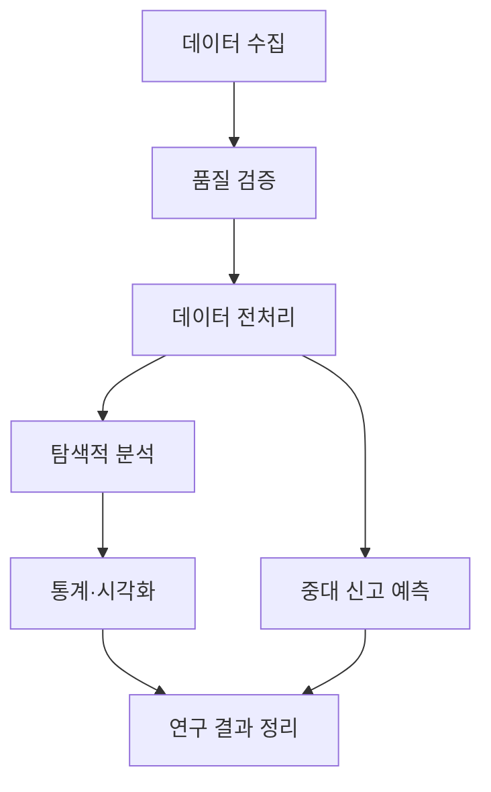

<div align="center">

# GLP-1 계열 의약품 이상사례 분석

### 이상사례 보고 패턴 분석 및 머신러닝 기반 중대 신고 여부 예측

**통계 분석 · 데이터 탐색 · 인터랙티브 시각화 · 머신러닝**

---

[프로젝트 소개](#프로젝트-소개) · [데이터 구성](#데이터-구성) · [분석 내용](#분석-내용) · [시각화](#데이터-시각화) · [예측 모델](#중대-신고-여부-예측) · [진행 현황](#진행-현황)

</div>

## 프로젝트 소개

- **연구 주제:** GLP-1 계열 의약품의 이상사례 보고 패턴 분석 및 머신러닝 기반 중대 신고 여부 예측
- **연구 목적:** 의약품별 신고 특성 및 중대 신고 패턴 파악
- **연구 방향:** 통계 분석과 탐색적 데이터 분석 중심
- **연구 방법:** 의약품·시계열·환자 특성별 분석, 인터랙티브 시각화, 머신러닝
- **최종 결과물:** 데이터 시각화 대시보드 및 학술대회 논문

### 주요 연구 영역

| 분석 영역 | 주요 내용 |
|---|---|
| 의약품별 분석 | 의약품별 전체 신고 건수 및 분포 |
| 시계열 분석 | 연도별 신고 추세 및 의약품별 변화 |
| 국가별 분석 | 국가별 이상사례 신고 현황 |
| 환자 특성 분석 | 성별·연령대별 중대 신고 비율 |
| 이상사례 분석 | 주요 이상사례 빈도 및 중대 신고 비율 |
| 머신러닝 | 중대 신고 여부 예측 및 주요 변수 분석 |

> **연구 범위**
>
> - 이상사례 신고 데이터의 통계적 특성 및 보고 패턴 분석
> - 신고 건수와 실제 부작용 발생률 구분
> - 중대 신고 비율과 실제 의약품 위험도 구분
> - 자발적 신고 데이터만으로 인과관계 판단 불가

---

## 데이터 구성

### 활용 데이터

| 구분 | 파일명 | 활용 목적 |
|---|---|---|
| 원본 데이터 | `adverse_events.csv` | Kaggle GLP-1 이상사례 보고 데이터 |
| 신고 단위 데이터 | `glp1_report_level.csv` | 신고 건수·중대 신고 분석 및 예측 |
| 이상사례 단위 데이터 | `glp1_reaction_level.csv` | 이상사례 유형별 빈도 및 특성 분석 |

### 데이터 전처리

- 중복 신고 ID 및 반복 기록 검토
- 결측치 및 비정상 값 확인
- 신고 날짜 유효성 검증
- 중대 신고 여부 라벨 생성 및 충돌 검토
- 신고 단위·이상사례 단위 데이터 구성
- 머신러닝 데이터 누수 가능성 검토

---

## 분석 내용

### 약물 및 시간에 따른 이상사례 보고 패턴

**담당: 서연**

- 약물별 전체 신고 건수 비교
- 연도별 이상사례 신고 건수 추이
- 약물별·연도별 신고 분포 히트맵
- 국가별 이상사례 보고 현황

### 환자 특성 및 이상사례 유형에 따른 중대 신고 패턴

**담당: 수연**

- 약물별 중대 신고 비율 비교
- 성별·연령대별 중대 신고 비율
- 주요 이상사례 신고 빈도 상위 15개
- 주요 이상사례별 중대 신고 비율

---

## 데이터 시각화

### 주요 시각화 항목

| 분석 영역 | 시각화 내용 |
|---|---|
| 약물별 신고 현황 | 약물별 전체 신고 건수 비교 |
| 연도별 추세 | 연도별 이상사례 신고 건수 변화 |
| 약물·연도별 분포 | 약물별·연도별 신고 분포 히트맵 |
| 국가별 현황 | 국가별 이상사례 신고 건수 |
| 약물별 중대 신고 | 약물별 중대 신고 비율 |
| 환자 특성 | 성별·연령대별 중대 신고 비율 |
| 주요 이상사례 | 신고 빈도 상위 15개 |
| 이상사례별 중대 신고 | 주요 이상사례별 중대 신고 비율 |

### 인터랙티브 대시보드

- 약물별 신고 현황 조회
- 연도 및 국가별 신고 패턴 탐색
- 성별·연령대별 중대 신고 비율 비교
- 주요 이상사례 유형별 분포 확인
- 조건별 필터링 및 결과 비교

**대시보드 링크:** 개발 후 추가

### 논문 수록용 시각화

- 주요 분석 결과 중심의 그래프 선정
- 2쪽 논문 분량을 고려한 그림·표 구성
- 300 DPI 이상 이미지 저장
- 그래프 색상·범례·축 표기 통일

---

## 중대 신고 여부 예측

### 머신러닝 모델 구성

| 항목 | 내용 |
|---|---|
| 예측 목표 | 중대 신고 여부 |
| 문제 유형 | 이진 분류 |
| 활용 데이터 | `glp1_report_level.csv` |
| 모델 개발 | 분류 모델 학습 및 성능 비교 |
| 성능 평가 | ROC-AUC, AP, F1-score, Recall |
| 결과 해석 | 주요 예측 변수 및 모델 성능 분석 |

### 모델 검증

- 중대 신고 라벨을 직접 결정하는 변수 제외
- 동일 신고의 학습·평가 데이터 중복 방지
- 클래스 불균형을 고려한 모델 성능 평가
- 데이터 누수 가능성 검토
- 예측 결과와 실제 의학적 위험도 구분

---

## 분석 파이프라인



### 활용 기술

| 구분 | 기술 |
|---|---|
| 프로그래밍 | Python |
| 데이터 처리 | Pandas, NumPy |
| 통계 분석 | SciPy |
| 데이터 시각화 | Matplotlib, Seaborn, Plotly |
| 머신러닝 | Scikit-learn |
| 개발 환경 | Google Colab |
| 버전 관리 | GitHub |

---

## 프로젝트 구조

```text
Data-Visualization-for-Big-Data-PBL-Team-06/
│
├── data/
│   ├── raw/
│   │   └── adverse_events.csv
│   └── processed/
│       ├── glp1_report_level.csv
│       └── glp1_reaction_level.csv
│
├── notebooks/
│   ├── preprocessing/
│   ├── eda/
│   └── modeling/
│
├── visualization/
│   ├── static/
│   └── interactive/
│
├── results/
│   ├── figures/
│   └── tables/
│
├── paper/
│
└── README.md
```

*권장 디렉터리 구조이며 실제 저장소 구성에 따라 변경 가능*

---

## 진행 현황

### 연구 일정

| 일정 | 진행 내용 |
|---|---|
| 완료 | 데이터 수집 및 전처리 |
| 11월 6일 | 탐색적 데이터 분석 |
| 11월 8일까지 | 시각화 제작 |
| 11월 9일 ~ 12일 | 머신러닝 모델 개발 |
| 11월 10일까지 | 분석 결과 정리 |
| 11월 13일까지 | 논문 그림·표 구성 |
| 11월 13일 ~ 16일 | 논문 초안 작성 |
| 11월 17일 ~ 19일 | 논문 최종 검토 및 수정 |
| **11월 20일** | **학술대회 논문 제출** |

### 작업 현황

- [x] 데이터 수집
- [x] 데이터 전처리
- [x] 약물별·시계열 탐색적 데이터 분석
- [x] 환자 특성 및 중대 신고 탐색적 데이터 분석
- [ ] 데이터 시각화 최종 정리
- [ ] 머신러닝 모델 개발 및 평가
- [ ] 인터랙티브 대시보드 제작
- [ ] 논문 그림·표 확정
- [ ] 논문 작성 및 최종 검토
- [ ] 학술대회 논문 제출

---

## 학술대회 및 연구 성과

### 한국디지털산업학회 2026 추계학술대회

| 항목 | 내용 |
|---|---|
| 논문 제출 마감 | 2026.11.20 |
| 발표 여부 통보 | 2026.11.27 |
| 사전등록 마감 | 2026.12.04 |
| 학술대회 일정 | 2026.12.11 ~ 12.12 |
| 발표 예정일 | 2026.12.12 |
| 장소 | 숙명여자대학교 |
| 논문 분량 | 2쪽 |

### 최종 결과물

- 데이터 전처리 및 품질 검증 결과
- 약물별·시계열 이상사례 보고 패턴 분석
- 환자 특성 및 이상사례 유형별 중대 신고 분석
- 논문 수록용 통계 그래프 및 표
- 인터랙티브 데이터 시각화 대시보드
- 머신러닝 기반 중대 신고 여부 예측 결과
- 학술대회 제출 논문

---

## 연구팀

**덕성여자대학교 데이터사이언스학과 · Team 06**

| 담당 | 연구 내용 |
|---|---|
| 서연 | 약물 및 시간에 따른 이상사례 보고 패턴 분석 |
| 수연 | 환자 특성 및 이상사례 유형에 따른 중대 신고 패턴 분석 |
| 공동 | 머신러닝 예측, 시각화 통합 및 논문 작성 |

---

<div align="center">

**GLP-1 Safety Analytics**

<sub>2026 · Team 06</sub>

</div>
